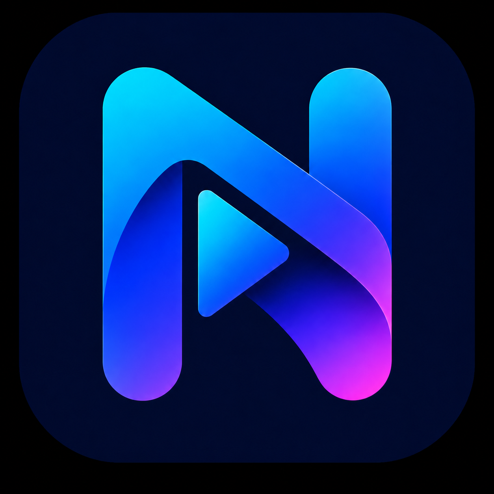
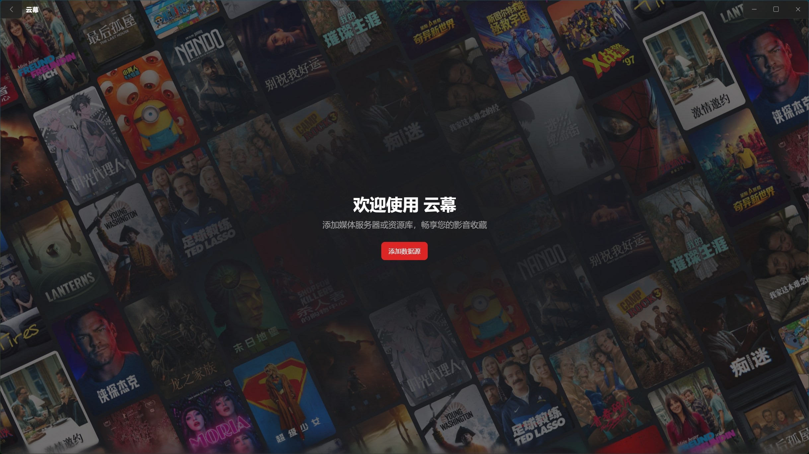
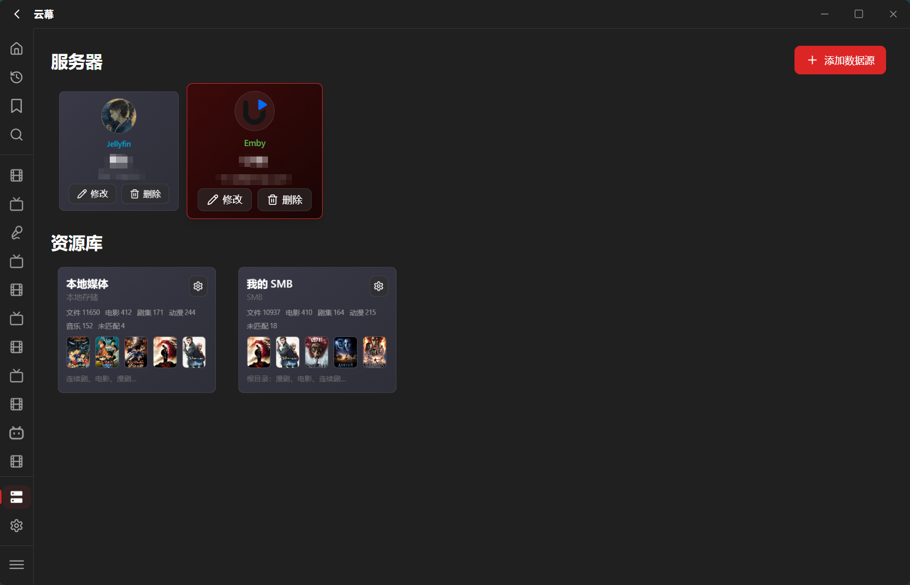
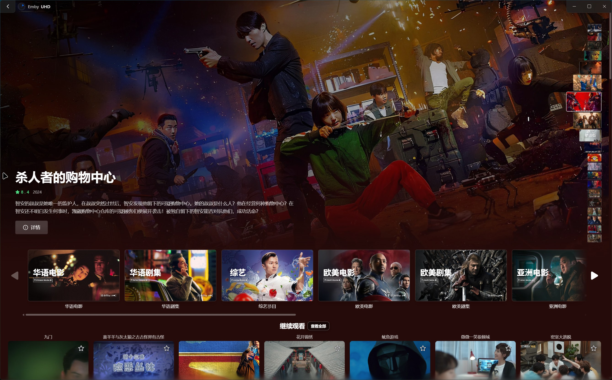
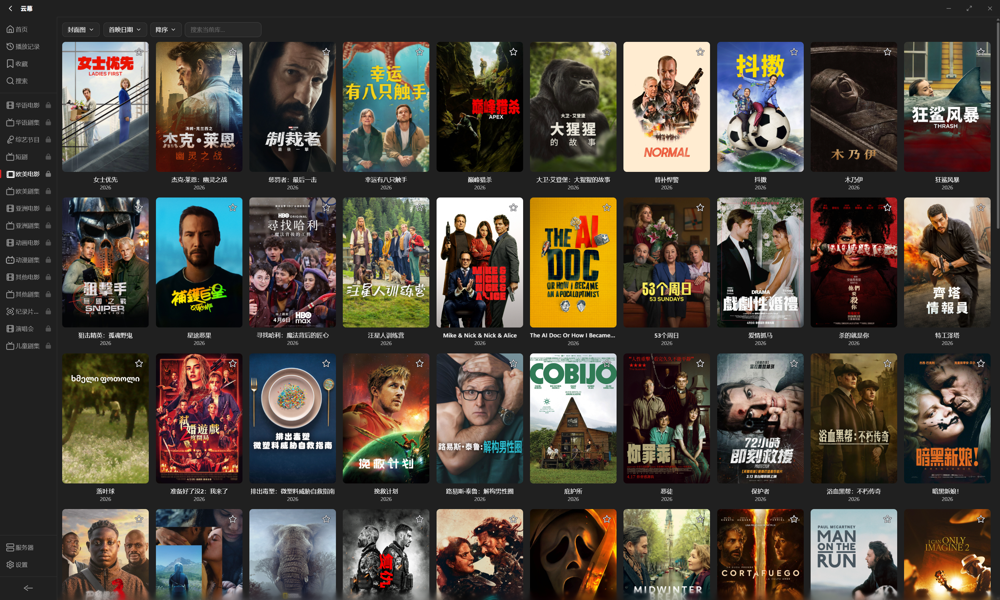
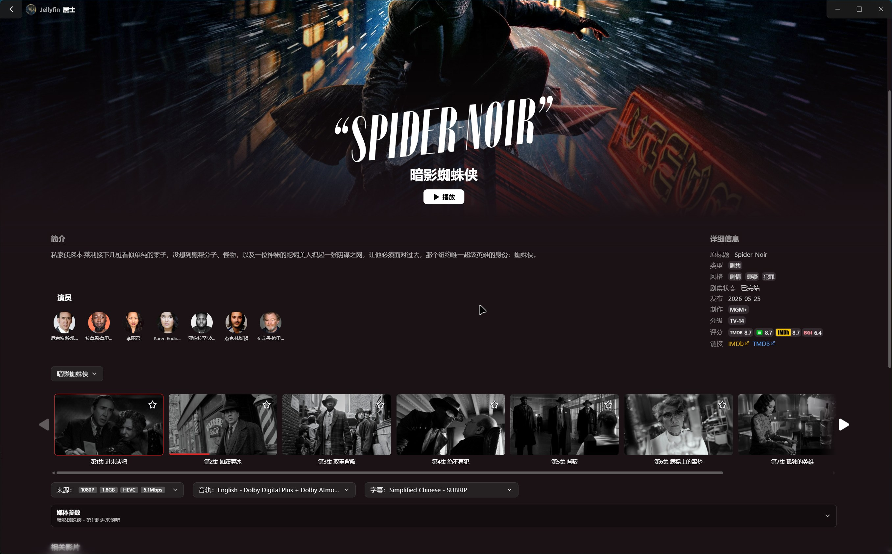
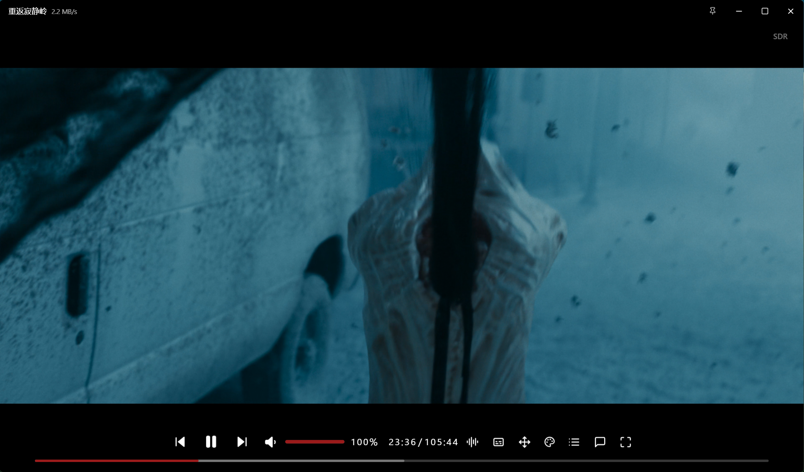

[中文](README.md) | **English** | [日本語](README_ja.md) | [한국어](README_ko.md) | [Русский](README_ru.md)

# Nimbus Player

**Less switching. More immersion.**

Connect Jellyfin, Emby, Plex, FnVideo, local folders, SMB, WebDAV, and 115 Cloud in one Windows desktop client for browsing, organizing, and playing your media

[Official website](https://nimbus-player-website.pages.dev/?lang=en) · [Announcements](https://t.me/NimbusPlayerwindows)

Availability depends on your installed version, source permissions and the corresponding service

[Download from Microsoft Store](https://apps.microsoft.com/detail/9nzgd27nw89w?hl=en-US&gl=US) · [Issues](https://github.com/JushiZen/Nimbus.Player/issues) · [Telegram](https://t.me/+Hn3h4sGJohE2ZTll) · [QQ Group](https://qun.qq.com/universal-share/share?ac=1&authKey=LjYdpVHMQlu%2Fm4KaPKGEIVrmMQzhUHlAsb8nPCZpV94NgHIkp43hy%2FX3YWeEKwjm&busi_data=eyJncm91cENvZGUiOiI5NDgwMzYyNzUiLCJ0b2tlbiI6ImgyRGFrbEx2YkRjRkx0dFBuQnRCWURpVHFTNkQ2TmNOUEdjNjZyTWFoRVd2TE9ja2FLTDFOZzcrMzREWDlkSVMiLCJ1aW4iOiI1OTc2MTcxNzQifQ%3D%3D&data=pl-4qcVh0wDEmxyu3FfeCqwg0wtnLT-vs0vphznkKBgMrIHHFuot3D1fdCSqNcoWk0Py6SCutin7tSwPlTCNAA&svctype=4&tempid=h5_group_info)

---

<h2 align="center">One Client for All Your Media Sources</h2>

Nimbus is a Windows media client for switching between supported media servers and direct storage in one application; favorites, progress, subtitles and version selection follow each source's capabilities and permissions

Media stays on your selected devices or services; Nimbus does not host libraries or supply films and TV shows

---

<h2 align="center">Highlights</h2>

### Unified Libraries

- Connect Jellyfin, Emby, Plex, and FnVideo
- Connect local folders, SMB, WebDAV, and 115 Cloud
- Switch between sources from one sidebar
- Poster walls, simple lists, search, favorites, history, and continue watching
- Search, sorting, pagination, favorites and progress depend on each source's API and permissions; they are not identical across every service

### Direct Library Organization

- Scan and organize ordinary movies and series using online identification or directory NFO and artwork
- Each local, SMB, WebDAV or 115 resource card independently selects Online / Local-first with online completion / Local-only; Online remains the default
- Read movie, series, season and episode metadata with common Emby/Kodi naming; use posters, backdrops, thumbnails and logos according to your settings
- Add posters, summaries, cast, and episode information
- Match manually, preview NFO imports and upload custom artwork in details; parsed metadata and image copies are saved without rewriting media files
- Rescans retain manual matching locks and imports; removing original uploaded files does not remove saved copies, while deleted automatic directory metadata follows the selected policy
- Scanning, rescanning, classification and metadata storage for large libraries
- Merge seasons of the same title to reduce duplicate cards
- Configure TMDB metadata and image mirrors separately, or clear them to restore defaults; JAV and music retain their independent workflows

### Playback

- A separate playback window keeps the library available while watching
- Embedded and external subtitles with display controls
- Hardware acceleration, color-space controls, picture presets, and network cache settings
- Optionally prefer the highest-bitrate version for multi-version Jellyfin, Emby, and Plex items
- Built-in MPV waits for actual playback completion before switching episodes by default; optionally set a positive lead time, with full playback when it reaches or exceeds the episode duration
- Manual episode selection, preloading and automatic/custom intro-outro skipping remain available where the selected source and player support them
- Playback diagnostics help identify failures

### Anime and Danmaku

- Anime identification and episode matching
- Multiple commonly used danmaku sources
- Adjustable speed, size, density, and display area
- Custom colors, white/original color options and black outlines, with separate main-player and FnVideo support
- Search and switch danmaku content during playback

### Music

- Browse and play music libraries
- Lyrics and word-by-word highlighting
- Embedded cover extraction for local and WebDAV audio
- Music metadata is separate from ordinary movie/series NFO and artwork policies; lyric effects depend on the available lyric files and source

### Settings and Watch Records

- Search setting names and descriptions across categories and jump to the matching controls
- Giant Screen navigation, transparency and page/poster transitions follow your settings, with return during poster entry; smooth performance on every device is not guaranteed
- Movie and series sorting options for Emby/Plex/Jellyfin depend on the server API
- Authorize Trakt separately and enable supported playback reporting, progress, history and collection features; imports depend on source support and matching, without a promise of universal two-way synchronization

---

<h2 align="center">Supported Sources</h2>

### Media Servers

**Jellyfin / Emby / Plex / FnVideo**

Use the server's address and login method; metadata, playback permissions, transcoding and progress follow that service's settings and capabilities, while directory policies do not replace server-side metadata

### Direct Storage

**Local folders / SMB / WebDAV / 115 Cloud**

Browse files or build resource libraries; local metadata means NFO and artwork in the selected source's media directories, so SMB, WebDAV and 115 still require a connection. Local-only disables automatic online completion for that card's ordinary movies and series, rather than making the whole app offline

---

<h2 align="center">Scope and Compatibility</h2>

- ISO/disc compatibility depends on file structure, media source and player; different structures and network sources may fail, and complete menu navigation or encrypted-disc decryption is not promised. Recognizing ISO, BDMV or DVD content does not guarantee successful playback
- JAV, music and media servers keep separate workflows; danmaku, subtitles, transcoding, lyrics and Trakt require the corresponding configuration, APIs and metadata, with different capabilities per source
- Entries marked as in development or unavailable are not released features; screenshots are examples, and layout, theme and available controls depend on your installed version and settings

---

<h2 align="center">Interface Preview</h2>

### Home

Browse recommendations, library categories, and continue watching.

### Servers and Libraries

Manage servers and direct libraries in one place.

### Library

Browse a poster wall with filtering and sorting.

### Details

View summaries, cast, episodes, media versions, and related titles.

### Player

The separate player window provides subtitle, danmaku, picture, and audio controls.

---

<h2 align="center">Data and Privacy</h2>

- Nimbus does not upload or host your media files
- Connection settings are saved; use a trusted device and protect your accounts and application data
- Local metadata, caches and feedback files use your selected data directory; server watch records and enabled Trakt synchronization send the relevant information to those services
- Online metadata, danmaku, subtitles and update checks contact their respective services when used; not every operation is offline
- Logs aim to hide sensitive information; always remove passwords, tokens, full server addresses, and private paths before submitting feedback

---

<h2 align="center">Download and Feedback</h2>

Nimbus is distributed and updated through the [Microsoft Store](https://apps.microsoft.com/detail/9nzgd27nw89w?hl=en-US&gl=US).

This repository is for **product information and issue tracking**. It does not contain the application source code and does not accept pull requests against private code.

Report problems or suggestions through [GitHub Issues](https://github.com/JushiZen/Nimbus.Player/issues), including your installed version, Windows environment, source, reproduction steps, expected and actual results; for playback issues, identify the built-in or external player and include relevant screenshots or error text

Settings → About → Feedback Logs saves a local feedback file and opens its folder; saving does not upload it. Review and remove sensitive information before attaching it yourself, and do not submit media files or usable account credentials

[Website feedback](https://nimbus-player-website.pages.dev/feedback.html?lang=en) and GitHub Issues store separate records; the website form accepts text and public links, so retain its WEB number and receipt link. Use GitHub Issues when you need file attachments or discussion

---

<h2 align="center">Thanks</h2>

  
Thank you to everyone who reports issues and helps improve Nimbus Player.

  <!-- CONTRIBUTORS-START -->
  
  
  
  
  
  
  
  
  
  
  
  
  
  
  
  
  
  
  
  
  
  
  
  
  
  
  
  
  <!-- CONTRIBUTORS-END -->

---

Third-party names, trademarks, and materials appearing in the application belong to their respective owners and are used only for identification and description.
